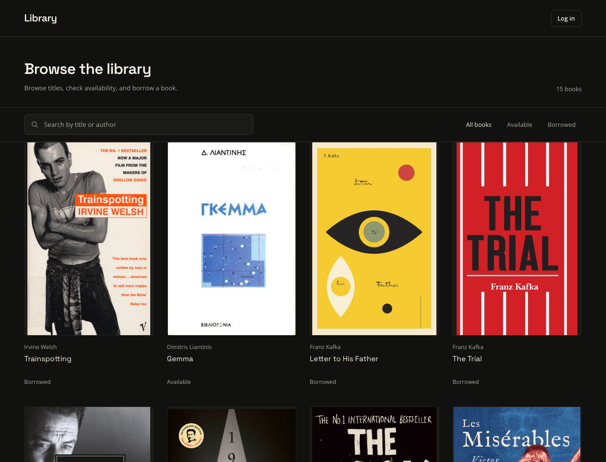
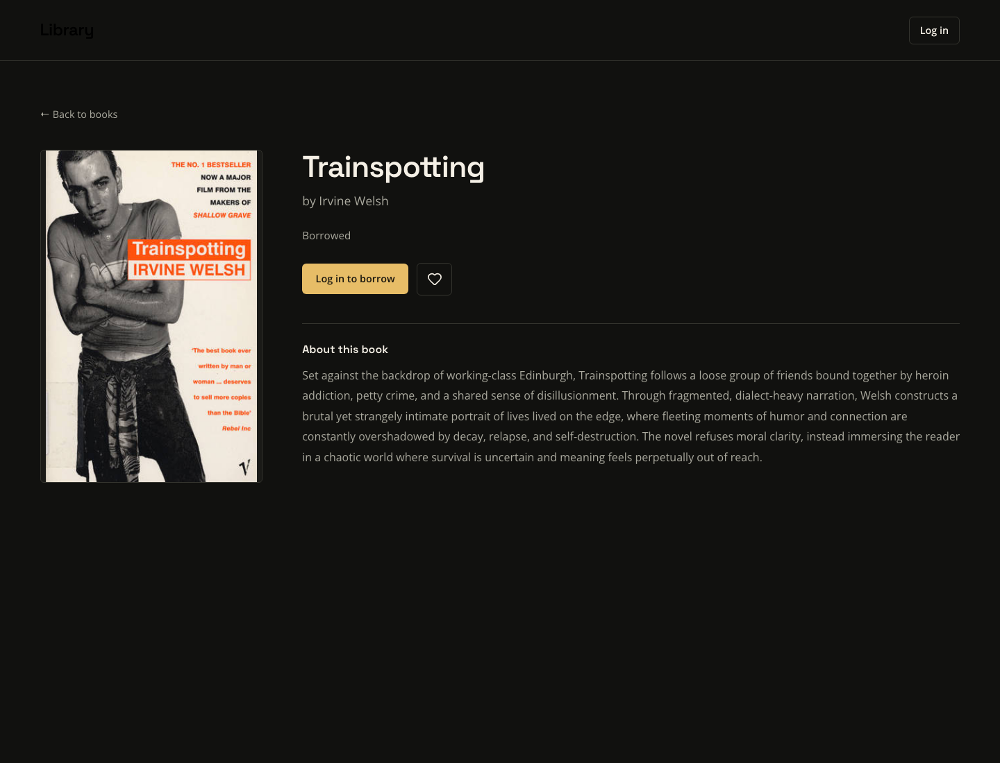

# Library

A full-stack library management application built with React, ASP.NET Core, and
SQLite. Users can browse books, manage their loans and favorites, and receive
real-time availability notifications through SignalR. Admins can manage the
book collection.

## Features

- Register, sign in, and sign out using ASP.NET Core Identity and authentication cookies.
- Browse books, search by title or author, and filter by availability.
- View book descriptions, cover images, and borrowing status.
- Borrow available books and return only books borrowed by your own account.
- Add and remove personal favorites, with a dedicated favorites page.
- Receive a dismissible SignalR toast when a favorite book is returned. The book
  title links to its details page.
- Admin-only book creation, editing, and deletion. New books can include a cover
  image URL or a local image path.
- Server-side validation: title and author are required, with a maximum of 150
  characters each; the optional description allows up to 5,000 characters.

## Screenshots

### Catalog



### Book details



## Technology

| Area | Stack |
| --- | --- |
| Frontend | React 19, Vite 8, JavaScript, React Router |
| UI | CSS, Motion, Lucide icons |
| Backend | ASP.NET Core Web API on .NET 10, ASP.NET Core Identity |
| Data | Entity Framework Core 10, SQLite |
| Real-time events | ASP.NET Core SignalR and the `@microsoft/signalr` JavaScript client |

## Run locally

Requirements:

- .NET 10 SDK.
- Node.js 20.19+ within the 20.x release line, or Node.js 22.12+.
- npm.

From the repository root:

```sh
npm install
npm --prefix frontend install
npm run dev
```

This starts both services with automatic reload:

| Service | Address |
| --- | --- |
| Frontend | http://localhost:5173 |
| Backend | http://localhost:5038 |
| SignalR Hub | http://localhost:5038/Notifications |

Press Ctrl+C to stop both services. To start them separately, use
`npm run dev:frontend` and `npm run dev:backend` in separate terminals.

Keep port **5173** available: the backend CORS policy allows that frontend
origin. The frontend API address is configured in
`frontend/src/services/apiConfig.js`; backend URLs are configured in
`backend/Properties/launchSettings.json`.

## Database

The repository includes `backend/library.db` with the current local data.
Registration, loans, favorites, and role assignments persist in that database.
Identity stores password hashes rather than plaintext passwords. SQLite's
`*.db-shm` and `*.db-wal` temporary files are ignored by Git.

To apply migrations, install the EF Core 10 CLI if you do not already have it:

```sh
dotnet tool install --global dotnet-ef --version '10.*'
```

Then, from `backend`:

```sh
dotnet ef database update
```

A fresh database does not automatically receive the supplied books or Admin
account. The application creates the `Admin` role at startup, but assigning
that role to a user is a separate step.

## Local test accounts

### Admin

This account is already assigned the `Admin` role in the supplied database:

| Email | Password |
| --- | --- |
| localadmin@example.com | LibraryAdmin2026! |

Open [Login](http://localhost:5173/login) to test adding, editing, and deleting
books. The account is not recreated at startup. Registering the same email in
a fresh database does not grant Admin privileges.

These are public local-demo credentials; use a different account and password
for any public deployment.

### Readers

Register these sample accounts at [Register](http://localhost:5173/register)
if they do not already exist in your local database:

| Account | Email | Password |
| --- | --- | --- |
| Reader 1 | reader1@example.com | LibraryTest1! |
| Reader 2 | reader2@example.com | LibraryTest2! |

New registrations are regular users. Each developer's database is independent;
registration on one machine does not create an account on another.

## SignalR notifications

After login, the React app connects to the authorized `/Notifications` Hub.
When a book is returned, the backend saves the return, finds users who have
that book in their favorites, and sends them a `BookAvailable` event containing
`bookId` and `title`. The frontend displays a toast with a link and a close button.
The connection is stopped when the user signs out.

Notifications are live events for connected users. They are not stored as a
notification history, and the toast shows the latest received event.

To test the complete flow:

1. Sign in as Reader 1 in a normal browser window.
2. Add an available book to favorites and keep that window open.
3. Confirm `SignalR Connected.` in the browser console.
4. Open a private/incognito window and sign in as Reader 2.
5. Borrow the same book, then return it.
6. Reader 1 should receive a toast. Test its book link and close button.

Use separate browser sessions, rather than two tabs sharing the same login cookie.

## API overview

All paths below use the backend address. Protected endpoints use the
signed-in user's Identity cookie; favorite requests do not accept a user ID.

| Method | Path | Access | Purpose |
| --- | --- | --- | --- |
| GET | `/api/Books` | Public | List books |
| GET | `/api/Books/{id}` | Public | Get a book |
| POST | `/api/Books` | Admin | Create a book |
| PUT | `/api/Books/{id}` | Admin | Edit a book |
| DELETE | `/api/Books/{id}` | Admin | Delete a book |
| POST | `/api/Books/{id}/borrow` | Signed in | Borrow a book |
| POST | `/api/Books/{id}/return` | Signed in | Return your own loan |
| GET | `/api/Favorites` | Signed in | List favorite books |
| POST | `/api/Favorites/{bookId}` | Signed in | Add a favorite |
| DELETE | `/api/Favorites/{bookId}` | Signed in | Remove a favorite |

For Postman, log in with `POST /login?useCookies=true` and a JSON body containing
`email` and `password`. Retain the returned cookie for protected requests.
A browser login does not authenticate Postman.

## Project structure

```text
backend/
  Controllers/       Book and favorite endpoints
  Data/              EF Core database context
  Hubs/              Authorized SignalR notifications Hub
  Migrations/        Database schema history
  Models/            Book and Favorite entities
  Program.cs         Services, Identity, CORS, and endpoint configuration
frontend/src/
  components/        Header, book cards, grid, and search controls
  pages/auth/        Login, registration, and logout
  pages/books/       Book details, management forms, and favorites
  routes/            Route definitions and authentication redirects
  services/          HTTP requests and shared API address
  App.jsx            Shared state, handlers, and SignalR connection
  index.css          Shared styles, favorites layout, and notification toast
```

Component and page styles generally live beside their JSX files; shared styles
are in `index.css`.

## Development checks

From the repository root:

```sh
npm --prefix frontend run build
npm --prefix frontend run lint
dotnet build backend/LibraryApi.csproj
```

The project currently has existing React effect lint findings in `App.jsx`.
There is no automated test suite; the two-user workflow above provides a manual
check of favorites and SignalR delivery.
